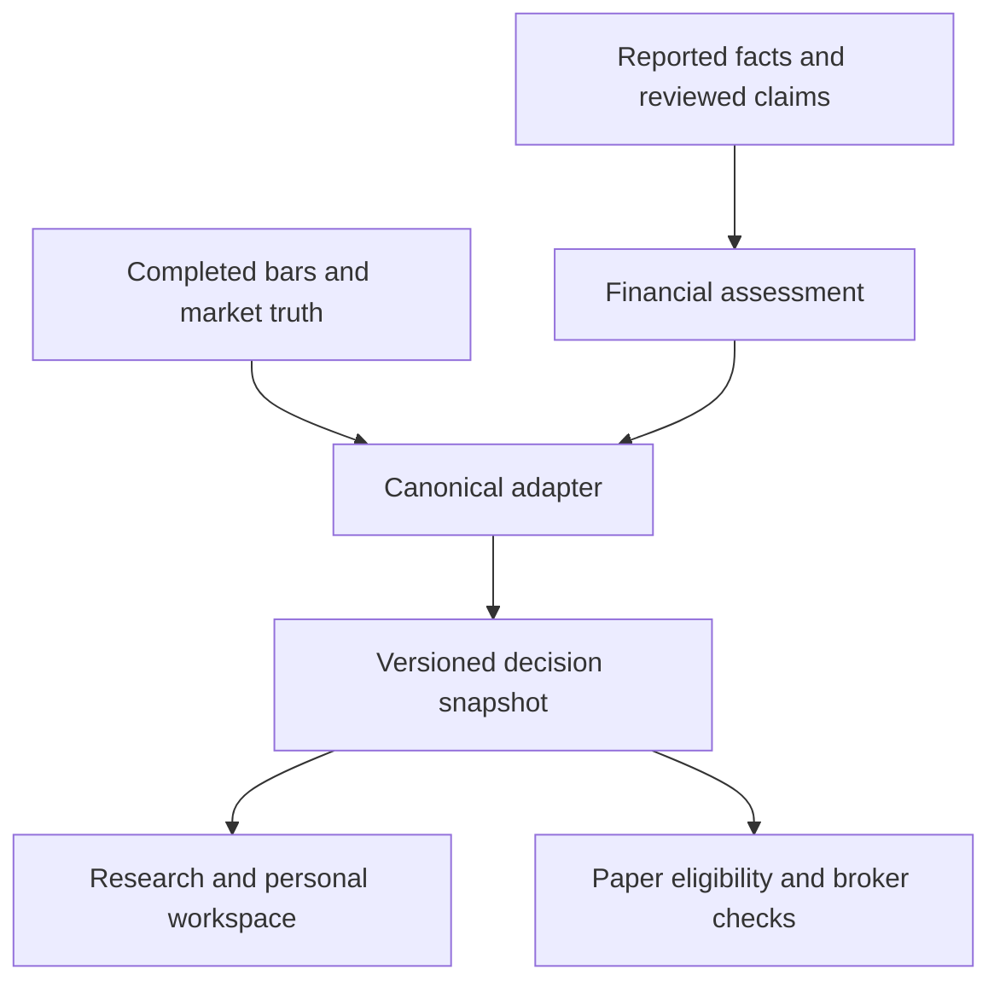

# Intelligence upgrade architecture

The existing Next.js App Router, React UI, Supabase account storage and provider integrations are retained. All investment execution is paper-only.

`lib/research-financial-assessment.ts` separates reported financial periods, business-model coverage, sourced thesis claims, funding and supported valuation scenarios. `company-source-reviews.ts` permits only trusted administrators to append reviewed SEC claims and listed-share reconciliation. Reviews are invalidated by a changed evidence revision. Personal what-if scenarios never overwrite this source.

`v931/canonical-assessment.ts` is shared by the browser research calculation and the autonomous server worker. Business, valuation, timing, evidence and execution are independent. `v995/persist-research.ts` stores the exact decision, raw completed-bar model and policy provenance. `v935/canonical.ts` rejects old client-authored snapshots for current decisions. `/api/validation/snapshot` accepts a symbol and recomputes server-side; it does not trust a client BUY decision.

The personal workspace stores watch reasons, comparison selections, saved evidence and in-app alerts. The planning journal freezes original evidence/plan records; reviews append. SQL policies isolate user-owned data. These new migrations are included and tested in isolated PostgreSQL/PGlite; they have not been applied to the live account.

Accumulation policies are experimental, capped allocations of an explicitly chosen contribution. Replay accepts point-in-time data, applies identical capital availability and costs, and separates deposits from investment outcome. No real historical dataset or model calibration is bundled as proof of performance.

Paper operations use trusted admin identity, current canonical research, database run leases, deterministic order intentions, available cash/position constraints, pause state, audit records and broker reconciliation. A diagnostics endpoint cannot submit orders. Paper mode starts paused after migration. Real-money execution is outside scope.

No additional feed or paid model was introduced. Provider quota/caching controls are retained. Full options-flow/gamma, universal valuation coverage and automatic self-training are not implemented capabilities.
